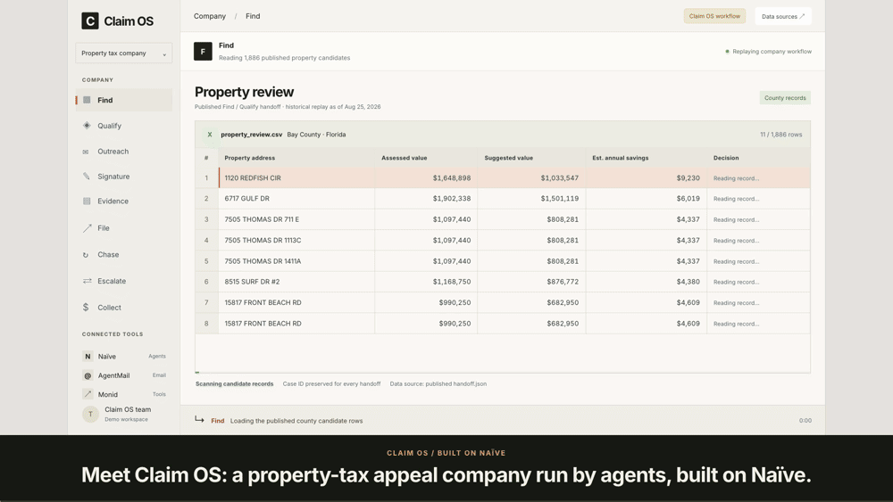
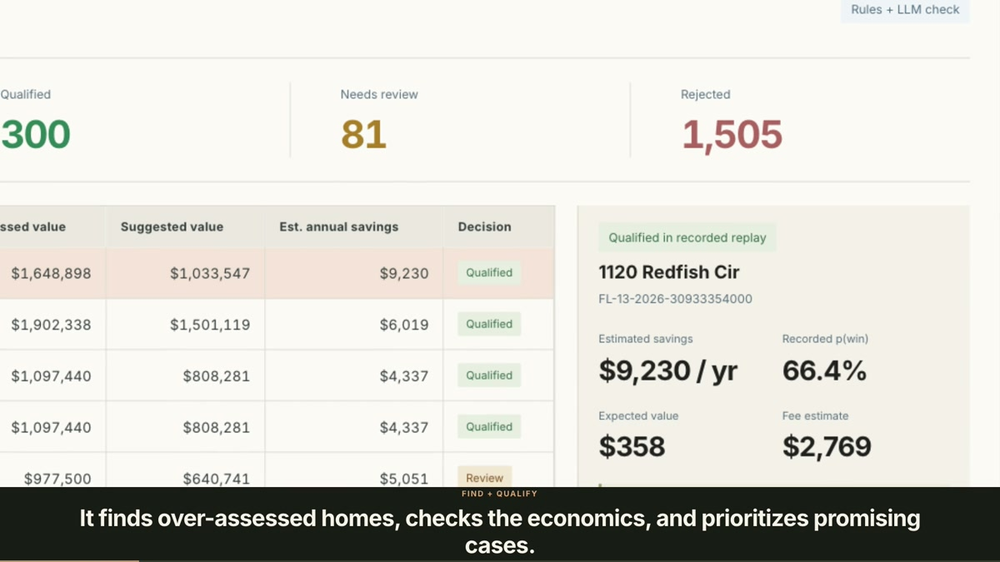
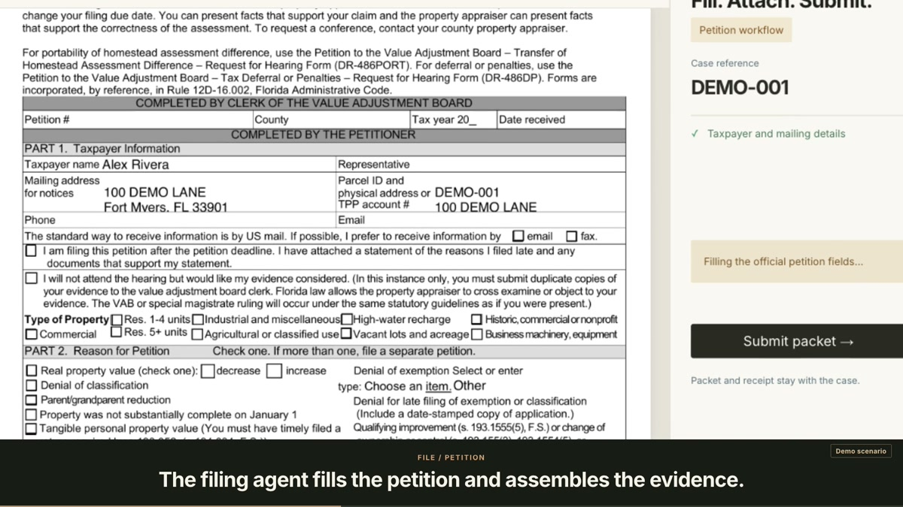
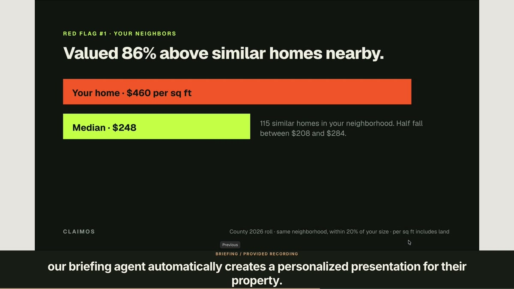
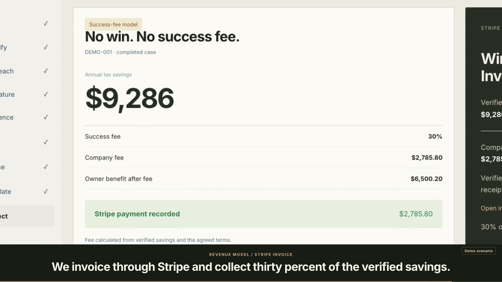
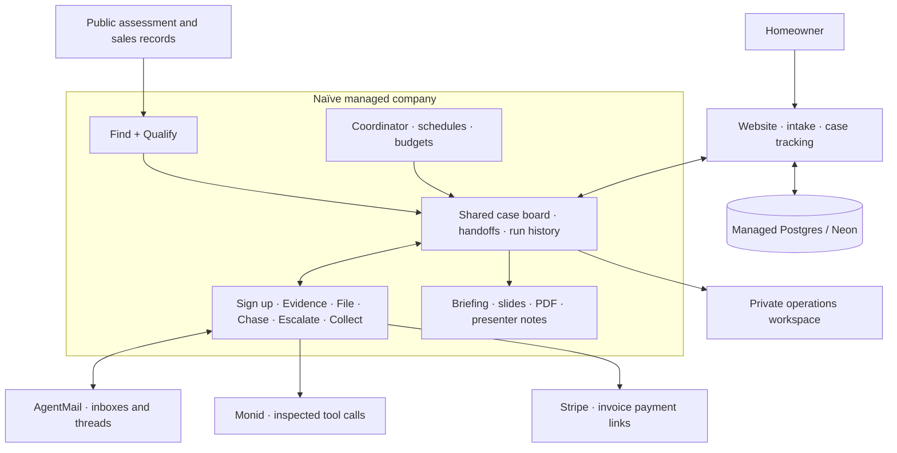

<div align="center">

# Claim OS

**Property-tax appeals, run by agents.**

Find the opportunity. Build the case. Follow it through. Get paid when the homeowner saves.

[Website](https://claimos-site-mds8vwd4myby.vercel.app/) · [Watch the 90-second demo](https://github.com/SmaranKudapa/claimos/blob/Video/videos/claimos-demo-90s/claimos-demo-90s.mp4?raw=true) · [Walkthrough](#walkthrough) · [Architecture](#architecture) · [Quick start](#quick-start)

<sub>Built at the Naïve × YC Autonomous Company Hackathon · San Francisco · November 7–8, 2026</sub><br/>
<sub>Powered by <a href="https://usenaive.ai">Naïve</a>, <a href="https://monid.ai">Monid</a>, <a href="https://agentmail.to">AgentMail</a> and <a href="https://stripe.com">Stripe</a>.</sub>

<br/>

<a href="https://github.com/SmaranKudapa/claimos/blob/Video/videos/claimos-demo-90s/claimos-demo-90s.mp4?raw=true"></a>

<sub>A product walkthrough with recorded data and supplied presentation footage. Filing and payment scenarios are labeled in the film.</sub>

</div>

## What it does

A promising property-tax appeal involves more than finding a low comparable sale. Someone has to check the rules, collect documents, prepare the petition, follow the county's response and verify the savings.

Claim OS organizes that work as an agent-run company on **Naïve SDK / Studio**. A coordinator routes cases across specialized desks. Each desk has tools, instructions and a budget; every handoff retains the case identity and the work behind it.

The first desk is **property tax**, starting with Florida public assessment and sales records. The owner-facing website provides property lookup, intake, case tracking and a professional-review request. That request can trigger a personalized briefing with **browser slides, a PDF and presenter notes**.

## Walkthrough

| **Find → Qualify** | **Evidence → File** |
| :--- | :--- |
|  |  |
| Screen county records, compare values and rank the cases worth investigating. Preserve the reason for qualifying, rejecting or requesting review. | Assemble the evidence and fill the official petition. Keep the document bundle, authority checks and receipt history attached to the same case. |

| **Website → Personal presentation** | **Outcome → Stripe invoice** |
| :--- | :--- |
|  |  |
| When an owner requests a licensed professional, the Briefing agent turns the case into a presentation explaining the numbers, limitations and next steps. | Collect checks the outcome against the corrected tax bill, calculates the agreed fee, and creates an invoice payment link through Stripe. |

The demo also shows **public-contact outreach**, a **speak-your-name signature preview**, and **Chase** following up in the same case thread.

[Watch the film](https://github.com/SmaranKudapa/claimos/blob/Video/videos/claimos-demo-90s/claimos-demo-90s.mp4?raw=true) · [Read the presenter script](https://github.com/SmaranKudapa/claimos/blob/Video/videos/claimos-demo-90s/presenter-script.txt)

## What actually ran

Selected execution records from November 8, 2026:

| Component | Recorded output |
| :--- | :--- |
| **Find · Hendry County** | **8,998 homes screened → 210 candidates**, including 72 strong and 25 possible cases. |
| **Qualify · same published dataset** | **97 decisions: 20 qualified, 2 needing review, 75 rejected.** Closed-window cases were explicitly evaluated as historical replay. |
| **File** | A filled, unsigned **DR-486**, a preparation manifest and a review page published as company artifacts. |
| **Coordinator** | A **nine-step dry run** completed with no tool errors or unintended dispatches. A subsequent internal ledger sync was repeatable without duplicate writes. |
| **AgentMail** | One approved operator-pilot invitation accepted by the provider, with its message and thread references retained. |
| **Stripe** | Invoice payment-link creation exercised in sandbox mode. |

These are execution results, not a claim of recovered taxes or paying customers. The revenue figures in the film illustrate the business model.

## How the company works

| Desk | Its job | What moves forward |
| :--- | :--- | :--- |
| **Find** | Screen assessment rolls and comparable sales. | A candidate, source references and a stable case ID. |
| **Qualify** | Check rules, dates and expected economics. | A decision with reasons and the selected route. |
| **Sign up** | Handle owner correspondence and collect the required information. | The owner thread, confirmation and authorization records. |
| **Evidence** | Assemble comparisons, records and owner-supplied material. | A sourced packet with its limitations and missing items. |
| **File** | Populate the petition and check the filing requirements. | The prepared packet, remaining holds and any actual filing receipt. |
| **Chase** | Follow up on outstanding requests and attach responses. | The updated thread, deadlines and decision letters. |
| **Escalate** | Interpret the decision and choose the next supported step. | A correction, another appeal step, closure or a Collect handoff. |
| **Collect** | Verify savings and calculate the agreed fee. | An invoice, Stripe link and payment status. |

**The supporting crew:** the Coordinator keeps cases moving; Briefing prepares owner presentations; Outreach handles external information requests; Site-sync keeps the website aligned with company records.

A missing signature or county response becomes a recorded dependency. The next pass can resume the case when the required information arrives.

## Architecture



Four native app surfaces support the company: **claimos-site** for owners, **claimos-ops** for operators, **claimos-flow** for coordination, and **claimos-pay** for Stripe payment links.

### Engineering that matters

- **Programs produce decisions.** Step agents execute their programs and preserve their outputs; case decisions have a traceable source.
- **Identity survives the handoff.** Find's case ID follows the packet, correspondence, decision and invoice. Document hashes bind artifacts to their bytes.
- **Retries preserve work.** Idempotency keys and stored provider receipts help prevent duplicate sessions, sends and payment links.
- **Provider success is checked.** A Monid job marked complete still needs a successful provider response. An agent saying “done” does not establish a filing or payment.
- **Private state stays private.** Provider keys remain server-side. Owner access and the native workspace's Studio authentication protect case details.

## Revenue model

**No win, no success fee.** The model charges **30% of the first year's verified tax savings**, under the owner's agreed terms. An invoice is paid through a **Stripe payment link** after the outcome is verified.

| Illustrative completed case | Amount |
| :--- | ---: |
| Annual tax savings | $9,286.00 |
| Claim OS fee · 30% | **$2,785.80** |
| Owner benefit after the fee | **$6,500.20** |

These are example economics, not recorded revenue. Operating costs include data and model use, correspondence, filing charges and any required professional work.

## Technology

| Layer | Technology |
| :--- | :--- |
| Agent runtime | **Naïve SDK / Studio** — managed agents, versioned sessions, boards and budgets |
| Tools and correspondence | **Monid**, **AgentMail** |
| Payments | **Stripe** payment links and payment-status receipts |
| Company programs | **TypeScript**, **Python**, Node.js **24+** |
| Product surfaces | HTML/CSS/JavaScript; **Next.js / React** for the native workspace |
| Storage and hosting | **SQLite** locally, **Postgres / Neon** for durable state, **Vercel** |
| Demo | Code-driven animation, **HyperFrames**, **FFmpeg**, matching narration subtitles |

## Repository map

| Path | Purpose |
| :--- | :--- |
| [`src/`](src/), [`public/`](public/), [`api/`](api/) | Company runtime, local workspace and API |
| [`flow/`](flow/) | Coordinator planning, shared-board reads and handoffs |
| [`collect/`](collect/) | Outcome verification and invoicing |
| [`pay/`](pay/) | Stripe payment-link and status tools |
| [`native-app/`](native-app/) | Studio-authenticated operations workspace |
| [`test/`](test/) | Runtime and provider-boundary tests |
| [`Video` branch](https://github.com/SmaranKudapa/claimos/tree/Video/videos/claimos-demo-90s) | Final film, presenter script and subtitles |

Step implementations also live on [`find`](https://github.com/SmaranKudapa/claimos/tree/find), [`qualify`](https://github.com/SmaranKudapa/claimos/tree/qualify), [`evidence`](https://github.com/SmaranKudapa/claimos/tree/evidence), [`codex/file-agent`](https://github.com/SmaranKudapa/claimos/tree/codex/file-agent), [`feat/escalate-step`](https://github.com/SmaranKudapa/claimos/tree/feat/escalate-step) and [`briefing`](https://github.com/SmaranKudapa/claimos/tree/briefing). Native deployments and branch integrations may be ahead of `main`.

## Quick start

### Explore the product

Open the [website](https://claimos-site-mds8vwd4myby.vercel.app/) or [watch the demo](https://github.com/SmaranKudapa/claimos/blob/Video/videos/claimos-demo-90s/claimos-demo-90s.mp4?raw=true). No provider keys are needed to watch the film.

### Run the company workspace

Use **Node.js 24 or newer**.

```bash
git clone https://github.com/SmaranKudapa/claimos.git
cd claimos
npm ci
cp .env.example .env
npm run dev
```

Open **http://127.0.0.1:4260**. Configure your provider credentials in `.env` before activating live work. Credentials stay on the server; real runs use your configured provider credits and budgets.

| Variable | Purpose |
| :--- | :--- |
| `NAIVE_API_KEY`, `NAIVE_MODEL` | Managed agent execution and model selection |
| `MONID_API_KEY` | Tool discovery and execution |
| `AGENTMAIL_API_KEY`, `AGENTMAIL_POD_ID` | Company inbox and correspondence |
| `CLAIMOS_OPERATOR_TOKEN` | Operator access for hosted API use |
| `DATABASE_URL` | Durable Postgres/Neon storage; omitted locally uses SQLite |
| `PORT` | Local server port; defaults to `4260` |

The `pay` native app separately uses its server-side `STRIPE_SECRET_KEY` and platform MCP bearer. The standalone worker requires `DATABASE_URL`:

```bash
npm run worker
```

### Checks

```bash
npm run verify
npm run build
npm run check:provenance
```

The verified runtime baseline passed **18 tests** with **one optional Neon integration test skipped**, plus type checking and the build. Run the commands above against your checkout for current results.

## Current scope

Claim OS is a hackathon build with live agent execution, sourced documents and tested provider integrations. A real filing still requires valid owner authority, a supported county route and a verified current deadline. The presentation feature serves browser slides and PDF; the film's voice-signature interaction is a feature preview. Closed-window qualification and illustrative payment outcomes remain distinguishable from live case results.

The eight-step workflow is the foundation for additional recovery desks. Each new jurisdiction or claim type needs its own reviewed rules, evidence requirements and filing adapter.

## Team

| Builder | Focus |
| :--- | :--- |
| [Nick](https://github.com/nick-devvv) | Find |
| [Smaran](https://github.com/SmaranKudapa) | Qualify, Escalate, Collect |
| [Francesco](https://github.com/francescorosciano) | Evidence |
| [Tarang](https://github.com/taranggoyal70) | File |

The website, coordination and presentation flow are shared work.

<div align="center">

**Claim OS. We win when homeowners win.**

[Try the website](https://claimos-site-mds8vwd4myby.vercel.app/) · [Watch the demo](https://github.com/SmaranKudapa/claimos/blob/Video/videos/claimos-demo-90s/claimos-demo-90s.mp4?raw=true)

</div>
